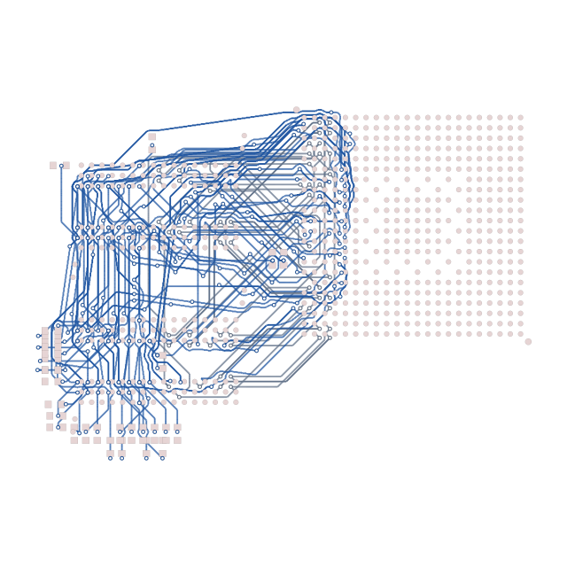
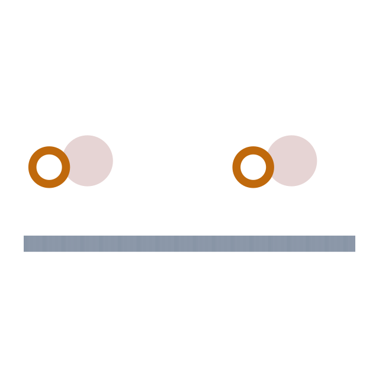
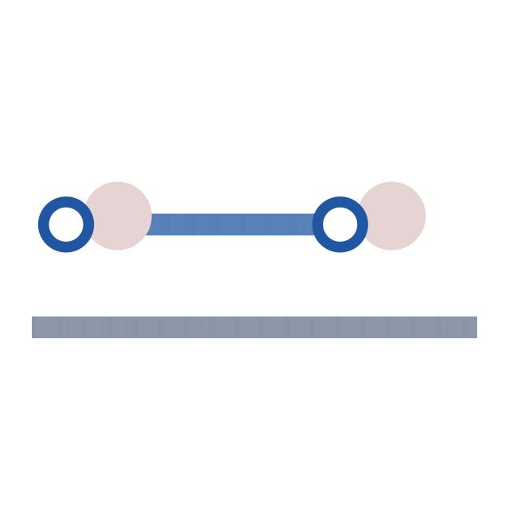

# @tscircuit/bga-escape-routing-solver

Pitch-aligned BGA escape and interconnect routing. Implements the
[`BaseSolver`](https://github.com/tscircuit/solver-utils) interface with
incremental stepping, progress, failure reasons and `visualize()`.

The solver reserves legal surface escapes and through-via sites before routing
the connections between them. Existing copper stays fixed and is supplied as
native wire/via traces.



## Usage

Install from GitHub:

```sh
bun add github:tscircuit/bga-escape-routing-solver
```

This complete example connects two BGA pads using a four-layer board:

```ts
import {
  BgaEscapeRoutingSolver,
  type BgaEscapeRoutingSolverInput,
} from "@tscircuit/bga-escape-routing-solver"

const pointsToConnect = [
  { x: -0.8, y: 0, layer: "top", pcb_port_id: "left" },
  { x: 0.8, y: 0, layer: "top", pcb_port_id: "right" },
]
const connections = [{ name: "CLOCK", pointsToConnect }]
const input: BgaEscapeRoutingSolverInput = {
  board: {
    bounds: { minX: -2, minY: -1.2, maxX: 2, maxY: 1.2 },
    layerCount: 4,
    minTraceWidth: 0.127,
    traceClearance: 0.127,
    viaToPadClearance: 0.127,
    via: { padDiameter: 0.327, holeDiameter: 0.2 },
    obstacles: pointsToConnect.map((point) => ({
      type: "rect",
      shape: "circle",
      center: { x: point.x, y: point.y },
      width: 0.4,
      height: 0.4,
      layers: ["top"],
      connectedTo: [point.pcb_port_id],
    })),
    connections,
    fixedTraces: [],
  },
  bga: { center: pointsToConnect[0]!, pitch: 0.8 },
  signalLayers: [0, 2],
  pointPairs: connections,
}

const solver = new BgaEscapeRoutingSolver(input)
solver.solve()
const traces = solver.getOutput()
```

`getOutput()` returns native `pcb_trace` records with wire widths, via dimensions,
branch names and endpoint port IDs. It throws unless the full solve completes.
Inspect `failed`, `error` and `failure` when a solve cannot complete.

## How it works

| Existing copper                                                                                           | Reserved escapes                                                                                                               | Completed connection                                                                                 |
| --------------------------------------------------------------------------------------------------------- | ------------------------------------------------------------------------------------------------------------------------------ | ---------------------------------------------------------------------------------------------------- |
|  |  |  |

1. Align a routing grid to the BGA ball pitch, including the channels between balls.
2. Count legal nearby via sites, then reserve escapes for the most constrained terminals first.
3. Connect the supplied point pairs across the permitted signal layers.

The caller supplies board selection, resolved rules and the original point pairs.
It also performs final whole-board DRC before accepting the result.

## Input

| Field                                                                                 | Meaning                                                             |
| ------------------------------------------------------------------------------------- | ------------------------------------------------------------------- |
| `board.bounds`, `board.obstacles`                                                     | Board boundary and physical pads/keepouts.                          |
| `board.connections`                                                                   | Electrical nets and their surface terminals.                        |
| `board.fixedTraces`                                                                   | Existing native copper that must remain fixed.                      |
| `board.minTraceWidth`, `board.traceClearance`, `board.viaToPadClearance`, `board.via` | Resolved wire, clearance and drill rules in millimetres.            |
| `bga.center`, `bga.pitch`                                                             | A ball-grid anchor and the ball pitch.                              |
| `signalLayers`                                                                        | Permitted layer indices, including at least one inner signal layer. |
| `pointPairs`                                                                          | Original two-terminal branches spanning each net.                   |

Coordinates are board-world points in millimetres: +X right, +Y up, right-handed
with +Z above. Layer indices increase from top (`0`) to bottom (`layerCount - 1`);
they are distinct from physical Z coordinates. See the [input/output types](lib/bga-escape-routing/types.ts).

The grid and reusable search workspace share a 128 MiB allocation budget. An
unsupported or blocked input fails explicitly rather than publishing partial routes.

## Visual debugger

```sh
bun install
bun start
```

Open the local URL printed by Cosmos and choose a page:

- **two-pad-escape** steps through the small example above with an additional fixed inner-layer trace.
- **stm32mp157-ddr** replays the real board: 710 pads, 32 fixed data-byte traces,
  137 terminals and 97 remaining branches.

Use **Step**, **Solve**, **Animate** and the layer selector to inspect each stage.
Reload the fixture to reset it. Gray traces are fixed copper, amber traces are reserved escapes and blue
traces are completed connections. Inner-layer wires are dashed; circles show
via copper and drill holes. Styling is bundled with the debugger.

## Development

```sh
bun test
bun run typecheck
bun run format:check
bun run build:site
```

`build:site` writes the static debugger to `cosmos-export/`. CI builds it and
uploads a `solver-debugger` artifact. Tests include the real STM32 board, blocked
escapes, fixed inner copper, pitch alignment, the grid budget and SVG snapshots.

This follows the handbook's
[GitHub-vanilla package layout](https://github.com/tscircuit/handbook/blob/main/guides/bootstrapping-repos.md):
`lib/index.ts` is the package entry and only `lib` is installed. No package build
step or lockfile is required.

## Fixture source and license

The STM32MP157 fixture is adapted from the OLIMEX STMP157-OLinuXino-LIME2 rev B1
design by OLIMEX Ltd. under CC BY-SA 3.0 US. It preserves the remaining routing
phase captured from tscircuit 0.0.3278 and its original Pipeline9 point pairs.

[KiCad source](https://github.com/OLIMEX/OLINUXINO/tree/85eee9c17ee13af65617d73bdd94de7ec49cfb42/HARDWARE/STMP157-OLinuXino-LIME2)
· [Native TSX source](https://github.com/ShiboSoftwareDev/core-ddr-benchmark/tree/24dc44c166d4258c3538f8b1f66953f1b6f58690/circuits)
· [Fixture license](https://creativecommons.org/licenses/by-sa/3.0/us/)

The solver source is [MIT licensed](LICENSE).
